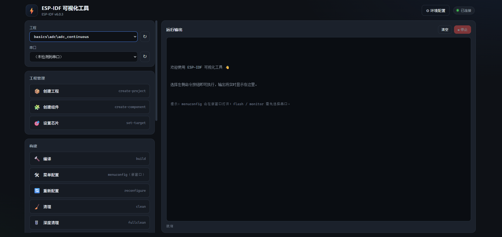
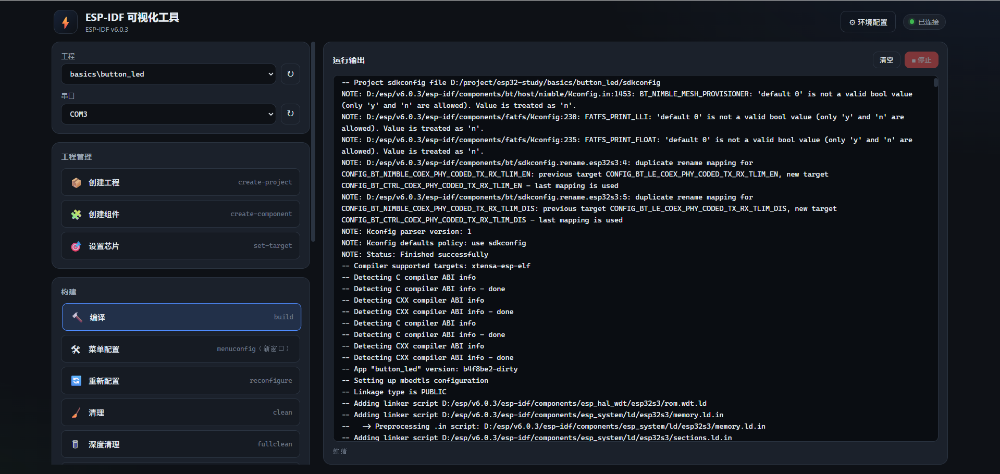
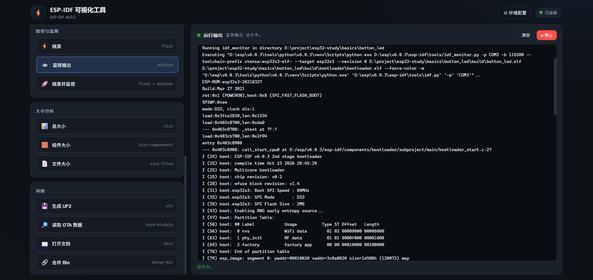

# ESP-IDF 可视化工具（idf-gui）

**简体中文** | [English](README_EN.md)

[](https://www.python.org/)
[](https://github.com/sofild/idf-gui)
[](https://github.com/sofild/idf-gui)
[](LICENSE)

把 `idf.py` 的常用命令变成点一下就能跑的可视化面板：自动探测 ESP-IDF 环境、工程目录与串口，实时流式回显命令输出。

只依赖 Python 标准库，不需要安装任何第三方包。

## 界面预览

### 主界面：选择工程与串口，点击命令即可执行



### 编译：实时流式输出构建日志



### 烧录并监视：串口日志直接回显在面板中



## 功能特性

- **零依赖后端**：仅使用 Python 标准库，`python server.py` 即启即用
- **环境自动探测**：自动查找 ESP-IDF 框架目录、Python 虚拟环境、IDF 版本号
- **工程自动发现**：递归扫描工程根目录，识别含 `project()` 声明的 ESP-IDF 工程
- **串口自动枚举**：调用系统接口列出当前可用串口（COM 口）
- **按钮式执行**：覆盖工程管理、构建、烧录与监视、大小分析等常用 `idf.py` 命令
- **实时流式回显**：后端逐行读取进程输出，通过 SSE 推送到前端终端
- **任务可中断**：一键停止当前任务，连同子进程树一起结束
- **交互命令独立窗口**：`menuconfig` 在真实控制台窗口打开，TUI 正常可用
- **本地私有**：服务固定监听 `127.0.0.1`，仅本机可访问

## 环境要求

| 项目 | 要求 |
| --- | --- |
| 操作系统 | Windows 10 / 11（依赖 PowerShell、`export.ps1` 与 `taskkill`） |
| Python | 3.7 及以上（无需第三方库） |
| ESP-IDF | 已安装并包含 `export.ps1`（v4.x / v5.x / v6.x 均可） |
| 硬件 | 开发板及对应 USB 串口驱动（如 CP210x、CH340） |

## 快速开始

1. 克隆仓库（或直接下载解压）：

   ```bash
   git clone https://github.com/sofild/idf-gui.git
   cd idf-gui
   ```

2. 启动服务（任选其一）：

   - 双击 `启动工具.bat`
   - 或命令行执行：

     ```bash
     python server.py
     ```

3. 浏览器会自动打开 `http://127.0.0.1:8000/`，看到顶部状态显示「已连接」即启动成功。

4. 若自动探测有偏差，点击右上角「⚙ 环境配置」，填写路径后保存，重启服务生效。

## 环境配置

配置保存在 `config.json`，首次启动会自动探测并回写。也可以直接在界面的「环境配置」面板修改。

| 字段 | 说明 | 示例 |
| --- | --- | --- |
| `idf_path` | ESP-IDF 框架目录（`IDF_PATH`） | `D:\esp\v6.0.3\esp-idf` |
| `idf_tools_path` | IDF 工具目录（`IDF_TOOLS_PATH`） | `D:\esp\v6.0.3` |
| `idf_python_env_path` | Python 虚拟环境目录（`IDF_PYTHON_ENV_PATH`） | `D:\esp\v6.0.3\tools\python\v6.0.3\venv` |
| `projects_root` | 工程根目录，递归扫描其中的 IDF 工程 | `D:\project\esp32-study` |
| `port` | 服务监听端口（仅本机） | `8000` |

自动探测会按以下顺序查找 IDF 框架目录：

1. 环境变量 `IDF_PATH`（需包含 `export.ps1`）
2. 常见安装目录：`D:\esp`、`D:\Espressif`、`C:\Espressif`、`C:\esp`、`%USERPROFILE%\esp`

> `config.json` 保存的是本机绝对路径。若要公开分享仓库，建议按需将其加入 `.gitignore`。

## 支持的命令

| 分组 | 命令 | 按钮 | 说明 |
| --- | --- | --- | --- |
| 工程管理 | `create-project` | 创建工程 | 在工程根目录下新建工程，需填写工程名称 |
| 工程管理 | `create-component` | 创建组件 | 在 `components/` 下新建组件 |
| 工程管理 | `set-target` | 设置芯片 | 选择目标芯片并执行 `set-target` |
| 构建 | `build` | 编译 | 增量编译 |
| 构建 | `menuconfig` | 菜单配置 | 在新控制台窗口中打开交互式配置界面 |
| 构建 | `reconfigure` | 重新配置 | 重新执行 CMake 配置 |
| 构建 | `clean` | 清理 | 删除构建产物（保留配置） |
| 构建 | `fullclean` | 深度清理 | 删除整个 `build` 目录 |
| 构建 | `python-clean` | 清理 Python | 清理 Python 缓存 |
| 烧录与监视 | `flash` | 烧录 | 需选择串口 |
| 烧录与监视 | `monitor` | 监视输出 | 需选择串口 |
| 烧录与监视 | `flash-monitor` | 烧录并监视 | 需选择串口，烧录后直接进入监视 |
| 大小分析 | `size` | 总大小 | 固件总体大小 |
| 大小分析 | `size-components` | 组件大小 | 按组件统计占用 |
| 大小分析 | `size-files` | 文件大小 | 按文件统计占用 |
| 其他 | `uf2` | 生成 UF2 | 生成 UF2 固件 |
| 其他 | `read-otadata` | 读取 OTA 数据 | 读取 otadata 分区内容 |
| 其他 | `docs` | 打开文档 | 打开对应版本的 IDF 文档 |
| 其他 | `merge-bin` | 合并 Bin | 可指定输出文件名与格式 |

支持的 `set-target` 芯片：`esp32`、`esp32s2`、`esp32s3`、`esp32c2`、`esp32c3`、`esp32c6`、`esp32h2`、`esp32p4`、`esp32c5`、`esp32c61`。

## 工作原理

1. 启动时读取（或自动探测）配置，确定 IDF 路径、工程根目录与串口列表。
2. 前端点击按钮后向 `POST /api/run` 提交命令；后端对串口、工程名、芯片型号做白名单校验，再拼接 `idf.py` 参数，避免命令注入。
3. 后端用 PowerShell 设置 `IDF_PATH` 等环境变量、加载 `export.ps1`，然后执行 `idf.py`。
4. 进程输出被逐行读入内存缓冲区，前端通过 `GET /api/stream?job=...`（SSE）实时接收。
5. 点击「停止」会调用 `taskkill /T /F` 结束整个进程树；`menuconfig` 例外，它在独立控制台窗口中运行。

## 项目结构

```text
idf-gui/
├─ server.py            # 本地 HTTP 服务、SSE 推送与 idf.py 调用
├─ config.json          # 本机环境配置（首次启动自动生成）
├─ web/                 # 前端界面（原生 HTML/CSS/JS，无需构建）
│  ├─ index.html
│  ├─ style.css
│  └─ app.js
├─ images/              # README 截图
├─ 启动工具.bat          # Windows 一键启动脚本
└─ LICENSE
```

## HTTP 接口

| 方法 | 路径 | 说明 |
| --- | --- | --- |
| GET | `/api/config` | 读取配置、IDF 版本、工程列表与串口列表 |
| GET | `/api/ports` | 刷新串口列表 |
| GET | `/api/jobs` | 列出当前任务 |
| GET | `/api/stream?job=<id>` | SSE 流式输出 |
| POST | `/api/run` | 启动任务 |
| POST | `/api/kill` | 停止任务 |
| POST | `/api/config` | 保存配置 |
| POST | `/api/redetect` | 重新自动探测 |

## 常见问题

**检测不到串口？**
确认 USB 线连接正常、串口驱动已安装，并点击串口下拉框旁的「↻」刷新。串口被其他工具（如串口助手）占用时也会检测不到或烧录失败。

**检测不到工程？**
工程目录需包含声明了 `project(...)` 的 `CMakeLists.txt`；扫描最多递归 6 层，并会跳过 `build`、`managed_components`、`.git` 等目录。

**端口被占用？**
修改 `config.json` 中的 `port` 后重启服务。

**`menuconfig` 没有输出？**
这是预期行为：该命令需要真实控制台才能绘制 TUI，因此会在新窗口打开，不在网页终端回显。

**能在 Linux / macOS 上运行吗？**
当前版本通过 Windows PowerShell 调用 `idf.py`，仅支持 Windows。

## 许可证

本项目基于 [Apache License 2.0](LICENSE) 开源。
