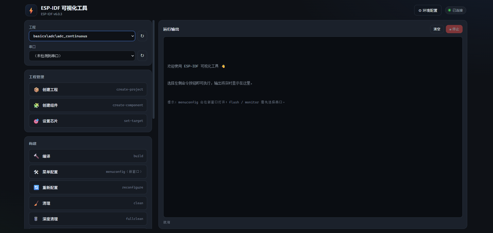
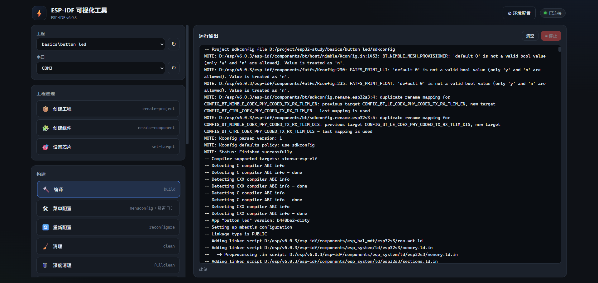
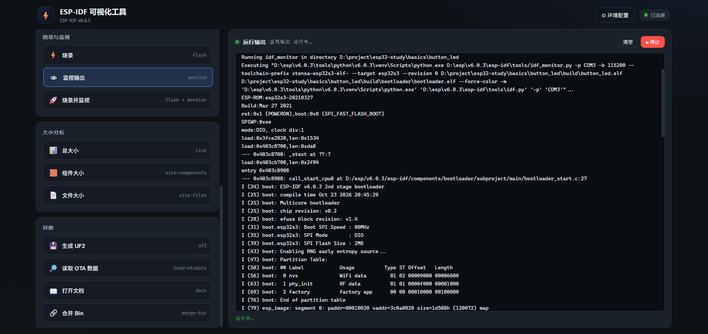

# ESP-IDF GUI (idf-gui)

[简体中文](README.md) | **English**

[](https://www.python.org/)
[](https://github.com/sofild/idf-gui)
[](https://github.com/sofild/idf-gui)
[](LICENSE)

A web-based visual front-end for `idf.py`: it auto-detects your ESP-IDF environment, project directories and serial ports, and streams command output to the browser in real time.

Built with the Python standard library only — no third-party packages required.

## Screenshots

### Main window: pick a project and port, then click a command



### Build: live-streamed build log



### Flash and monitor: serial log shown right in the panel



## Features

- **Zero-dependency backend** — pure Python standard library, just run `python server.py`
- **Environment auto-detection** — finds the ESP-IDF directory, Python virtual environment, and IDF version
- **Project auto-discovery** — recursively scans your projects root for ESP-IDF projects with a `project()` declaration
- **Serial port enumeration** — lists currently available COM ports via the OS
- **One-click commands** — covers project management, build, flash/monitor and size analysis
- **Live output streaming** — reads process output line by line and pushes it to the browser over SSE
- **Cancellable jobs** — stop the running task and its whole process tree
- **Interactive commands in their own window** — `menuconfig` opens in a real console so its TUI works
- **Local only** — the server binds to `127.0.0.1`

## Requirements

| Item | Requirement |
| --- | --- |
| OS | Windows 10 / 11 (uses PowerShell, `export.ps1` and `taskkill`) |
| Python | 3.7+ (no third-party libraries) |
| ESP-IDF | Installed with `export.ps1` (v4.x / v5.x / v6.x) |
| Hardware | A dev board and its USB serial driver (e.g. CP210x, CH340) |

## Quick Start

1. Clone the repository (or download and extract it):

   ```bash
   git clone https://github.com/sofild/idf-gui.git
   cd idf-gui
   ```

2. Start the server (either way):

   - Double-click `启动工具.bat`
   - Or run:

     ```bash
     python server.py
     ```

3. Your browser opens `http://127.0.0.1:8000/` automatically. The status indicator at the top right should read “已连接” (connected).

4. If auto-detection misses something, click “⚙ 环境配置” (Environment Settings) in the top right, fill in the paths, save, and restart the server.

## Configuration

Settings live in `config.json`, which is auto-generated on first launch. They can also be edited in the Environment Settings panel.

| Field | Description | Example |
| --- | --- | --- |
| `idf_path` | ESP-IDF framework directory (`IDF_PATH`) | `D:\esp\v6.0.3\esp-idf` |
| `idf_tools_path` | IDF tools directory (`IDF_TOOLS_PATH`) | `D:\esp\v6.0.3` |
| `idf_python_env_path` | Python virtual environment (`IDF_PYTHON_ENV_PATH`) | `D:\esp\v6.0.3\tools\python\v6.0.3\venv` |
| `projects_root` | Projects root; scanned recursively for IDF projects | `D:\project\esp32-study` |
| `port` | Local server port | `8000` |

The IDF framework directory is searched in this order:

1. The `IDF_PATH` environment variable (must contain `export.ps1`)
2. Common install locations: `D:\esp`, `D:\Espressif`, `C:\Espressif`, `C:\esp`, `%USERPROFILE%\esp`

> `config.json` stores absolute local paths. If you publish this repository, consider adding it to `.gitignore`.

## Supported Commands

| Group | Command | Button | Description |
| --- | --- | --- | --- |
| Project | `create-project` | Create project | Creates a project under the projects root; requires a name |
| Project | `create-component` | Create component | Creates a component under `components/` |
| Project | `set-target` | Set target | Selects the target chip and runs `set-target` |
| Build | `build` | Build | Incremental build |
| Build | `menuconfig` | Menuconfig | Opens the interactive config UI in a new console window |
| Build | `reconfigure` | Reconfigure | Re-runs CMake configuration |
| Build | `clean` | Clean | Removes build artifacts (keeps configuration) |
| Build | `fullclean` | Full clean | Deletes the whole `build` directory |
| Build | `python-clean` | Clean Python | Clears Python caches |
| Flash & monitor | `flash` | Flash | Requires a serial port |
| Flash & monitor | `monitor` | Monitor | Requires a serial port |
| Flash & monitor | `flash-monitor` | Flash & monitor | Requires a serial port; flashes then monitors |
| Size analysis | `size` | Total size | Overall firmware size |
| Size analysis | `size-components` | Component size | Size grouped by component |
| Size analysis | `size-files` | File size | Size grouped by file |
| Other | `uf2` | Generate UF2 | Generates a UF2 firmware image |
| Other | `read-otadata` | Read OTA data | Reads the otadata partition |
| Other | `docs` | Open docs | Opens the IDF docs for your version |
| Other | `merge-bin` | Merge bins | Optional output name and format |

Supported `set-target` chips: `esp32`, `esp32s2`, `esp32s3`, `esp32c2`, `esp32c3`, `esp32c6`, `esp32h2`, `esp32p4`, `esp32c5`, `esp32c61`.

## How It Works

1. On startup the server loads (or auto-detects) the configuration: IDF path, projects root and serial ports.
2. A button click sends the command to `POST /api/run`. The backend validates the port, project/component name and chip model against allow-lists before building the `idf.py` argument list, preventing command injection.
3. PowerShell sets `IDF_PATH` and related variables, sources `export.ps1`, then runs `idf.py`.
4. Process output is buffered line by line in memory; the frontend receives it in real time via `GET /api/stream?job=...` (SSE).
5. “Stop” runs `taskkill /T /F` to terminate the whole process tree. `menuconfig` is the exception — it runs in a separate console window.

## Project Structure

```text
idf-gui/
├─ server.py            # HTTP server, SSE streaming and idf.py invocation
├─ config.json          # Local environment settings (generated on first launch)
├─ web/                 # Frontend (plain HTML/CSS/JS, no build step)
│  ├─ index.html
│  ├─ style.css
│  └─ app.js
├─ images/              # README screenshots
├─ 启动工具.bat          # One-click launcher for Windows
└─ LICENSE
```

## HTTP API

| Method | Path | Description |
| --- | --- | --- |
| GET | `/api/config` | Configuration, IDF version, projects and serial ports |
| GET | `/api/ports` | Refresh serial ports |
| GET | `/api/jobs` | List current jobs |
| GET | `/api/stream?job=<id>` | SSE output stream |
| POST | `/api/run` | Start a job |
| POST | `/api/kill` | Stop a job |
| POST | `/api/config` | Save configuration |
| POST | `/api/redetect` | Re-run auto-detection |

## FAQ

**No serial port detected?**
Check the USB cable and driver, then click the “↻” button next to the port selector. A port already held by another tool (e.g. a serial terminal) may also be missed or fail to flash.

**No project detected?**
The project directory must contain a `CMakeLists.txt` with a `project(...)` declaration. The scan goes at most 6 levels deep and skips `build`, `managed_components`, `.git` and similar directories.

**Port already in use?**
Change `port` in `config.json` and restart the server.

**`menuconfig` shows no output?**
That is expected: it needs a real console to draw its TUI, so it opens in a new window instead of streaming to the web terminal.

**Does it run on Linux / macOS?**
This version invokes `idf.py` through Windows PowerShell and supports Windows only.

## License

Released under the [Apache License 2.0](LICENSE).
